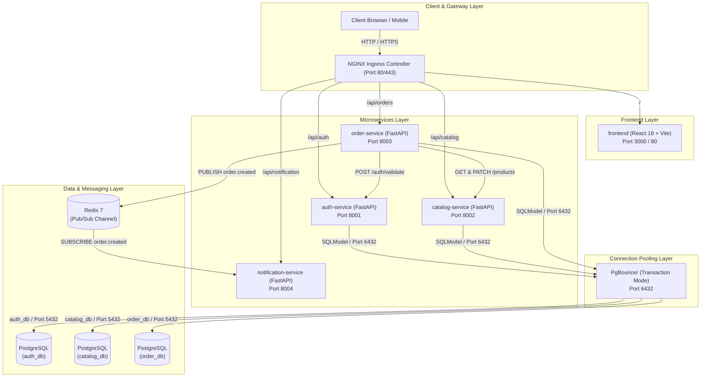
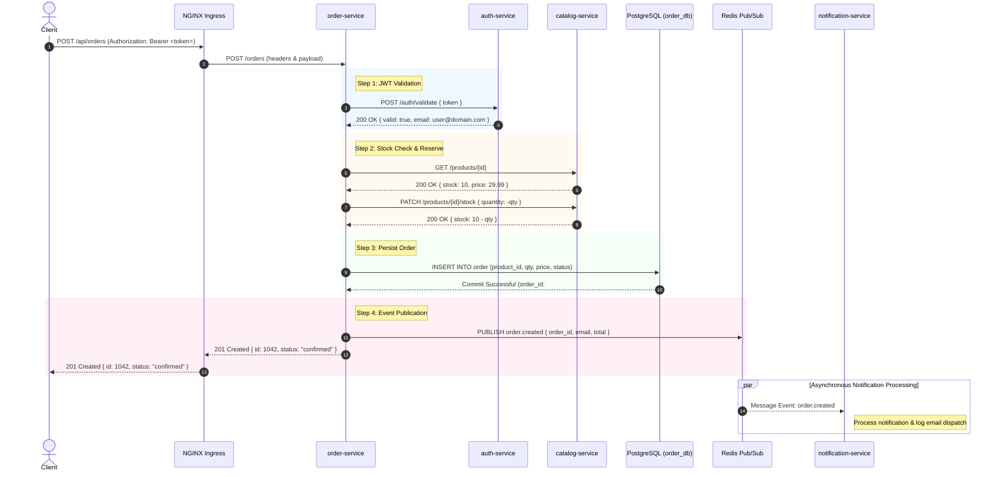

# OrbitStack Architecture & Design

OrbitStack is built as a cloud-native microservices platform demonstrating production patterns across API design, authentication, event-driven messaging, data isolation, and Kubernetes orchestration.

---

## 1. System Architecture

The diagram below illustrates the component topology, showing client traffic entering through the **NGINX Ingress Controller**, routing to backend services and the frontend client, and communicating with isolated storage and messaging layers.



---

## 2. Order Placement Sequence Diagram

The sequence diagram below details the synchronous inter-service orchestration and asynchronous event publishing during an order placement call (`POST /orders`).



---

## 3. Key Design Patterns

### Database-per-Service Isolation
Each microservice manages its own schema and database (`auth_db`, `catalog_db`, `order_db`). Services interact strictly via defined REST APIs or event contracts, eliminating direct cross-database queries.

### Asynchronous Event-Driven Messaging
Order creation is decoupled from notification delivery. `order-service` publishes an `order.created` event to Redis. `notification-service` consumes events asynchronously, preserving low latency for order execution.

### Unified Ingress Routing & Rate Limiting
External traffic is routed through the NGINX Ingress controller using declarative path rules (`/api/auth`, `/api/catalog`, `/api/orders`, `/api/notification`, `/`), providing a single gateway for the entire platform. IP-based rate limiting annotations (`nginx.ingress.kubernetes.io/limit-rpm`) protect authentication endpoints (`/api/auth/login`, `/api/auth/register`) at 100 req/min to prevent brute-force attacks, while enforcing a 300 req/min limit on all other `/api/*` routes.

### Distributed Tracing & Structured JSON Logging
All 4 microservices produce single-line JSON logs via `python-json-logger`. An `X-Request-ID` correlation header is automatically generated or preserved by `RequestTracingMiddleware` and propagated across inter-service HTTP requests (`order-service` $\rightarrow$ `auth-service`, `catalog-service`) and Redis event payloads (`notification-service`), enabling end-to-end trace visibility for every request.

### Connection Pooling with PgBouncer (Transaction Pooling Mode)
OrbitStack deploys **PgBouncer** as a dedicated connection pooler in front of PostgreSQL, running in **transaction pooling mode** (`pool_mode = transaction`):
- **Problem Solved**: PostgreSQL spawns an operating system process per connection, consuming approximately 10 MB of RAM per connection alongside process context-switching overhead. As Kubernetes pods scale dynamically (e.g. `catalog-service` scaling from 2 to 10 pods via HPA), hundreds of persistent client connections can easily saturate PostgreSQL's `max_connections` limit.
- **Transaction Pooling Mechanism**: Client pods maintain lightweight connections to PgBouncer. PgBouncer leases a physical PostgreSQL backend connection only for the lifespan of an active database transaction, immediately returning the backend connection to the pool upon `COMMIT` or `ROLLBACK`.
- **Prepared Statement Compatibility**:
  - Because transaction pooling may route successive transactions from the same client to different backend PostgreSQL processes, session-level named prepared statements will fail if referenced across connections (`prepared statement does not exist`).
  - Drivers that cache named prepared statements (such as `asyncpg`) must explicitly disable prepared statement caching (`statement_cache_size=0`, `prepared_statement_cache_size=0`).
  - `psycopg2` executes parameterized queries via unnamed prepared statements (`PQexecParams`), which are inherently stateless and natively compatible with PgBouncer transaction pooling.
  - SQLModel/SQLAlchemy engines are configured with `pool_pre_ping=True` to detect dropped or idle sockets before checkout, and `pool_recycle=300` to prevent stale socket accumulation.
  - PgBouncer enforces `server_reset_query = DISCARD ALL` to guarantee clean session state between pooled transactions, and `ignore_startup_parameters = extra_float_digits` to prevent connection negotiation failures.

---

## 4. Scaling with Database Read Replicas (Catalog Service)

At larger production scale, `catalog-service` exhibits a classic read-intensive workload profile where product browsing, search queries, and item detail views account for over 95% of database operations, while writes (catalog imports, inventory adjustments) represent less than 5%. 

Under traffic surges, scaling `catalog-service` from 2 to 10 pods via Kubernetes HPA creates high read concurrency that can saturate the CPU, disk I/O, and buffer cache of a single PostgreSQL primary. The PgBouncer pooling architecture extends seamlessly to support **PostgreSQL Read Replicas** with read-write splitting.

### 4.1 Topology & Dual-Pool Architecture

Rather than connecting all services and replicas to a single database node, PostgreSQL is configured in a **Primary-Follower** topology using streaming replication. PgBouncer manages distinct connection pools for read-write and read-only traffic:

```mermaid
flowchart TD
    subgraph AppLayer["Catalog Service Pods (HPA: 2-10 Replicas)"]
        Pod1["catalog-service Pod 1"]
        Pod2["catalog-service Pod 2"]
        PodN["catalog-service Pod N"]
    end

    subgraph Pooler["PgBouncer Connection Pooler (Port 6432)"]
        WritePool["Primary Pool\n(catalog_db_primary)\nTransaction Mode"]
        ReadPool["Replica Pool\n(catalog_db_replica)\nTransaction Mode"]
    end

    subgraph DBCluster["PostgreSQL Storage Cluster"]
        PGPrimary[("PostgreSQL Primary (Leader)\nRead / Write\nPort 5432")]
        Replica1[("PostgreSQL Replica 1 (Follower)\nStreaming Replication (Read-Only)")]
        Replica2[("PostgreSQL Replica 2 (Follower)\nStreaming Replication (Read-Only)")]
        ReplicaService["K8s Headless Service\n(postgres-ro.orbitstack.svc)"]
    end

    %% Application to PgBouncer Pools
    Pod1 -->|POST / PATCH (Writes)| WritePool
    Pod1 -->|GET (Reads)| ReadPool
    Pod2 -->|POST / PATCH (Writes)| WritePool
    Pod2 -->|GET (Reads)| ReadPool
    PodN -->|POST / PATCH (Writes)| WritePool
    PodN -->|GET (Reads)| ReadPool

    %% PgBouncer to Database Nodes
    WritePool -->|Read / Write Traffic| PGPrimary
    ReadPool -->|Load-Balanced Read Traffic| ReplicaService
    ReplicaService --> Replica1
    ReplicaService --> Replica2

    %% Replication Stream
    PGPrimary -.->|Streaming Replication (WAL)| Replica1
    PGPrimary -.->|Streaming Replication (WAL)| Replica2
```

### 4.2 PgBouncer Configuration for Read Replicas

PgBouncer routes traffic to the appropriate backend by defining distinct database aliases in `pgbouncer.ini`:

```ini
[databases]
; Write pool pointing directly to the PostgreSQL Primary
catalog_db_primary = host=postgres-primary.orbitstack.svc.cluster.local port=5432 dbname=catalog_db pool_mode=transaction max_db_connections=30

; Read pool pointing to the load-balanced Kubernetes Service for Read Replicas
catalog_db_replica = host=postgres-ro.orbitstack.svc.cluster.local port=5432 dbname=catalog_db pool_mode=transaction max_db_connections=100

[pgbouncer]
listen_port = 6432
listen_addr = 0.0.0.0
auth_type = scram-sha-256
auth_file = /etc/pgbouncer/userlist.txt
pool_mode = transaction
server_reset_query = DISCARD ALL
ignore_startup_parameters = extra_float_digits
```

### 4.3 Application-Layer Read/Write Splitting

In `catalog-service`, database connections are segregated into two dedicated engines or session dependencies:

1. **Environment Variables**:
   ```bash
   DATABASE_WRITE_URL=postgresql://postgres:<password>@pgbouncer:6432/catalog_db_primary
   DATABASE_READ_URL=postgresql://postgres:<password>@pgbouncer:6432/catalog_db_replica
   ```

2. **FastAPI Dependency Injection**:
   ```python
   # services/catalog-service/app/db/session.py
   write_engine = create_engine(DATABASE_WRITE_URL, pool_pre_ping=True, pool_recycle=300)
   read_engine = create_engine(DATABASE_READ_URL, pool_pre_ping=True, pool_recycle=300)

   def get_read_session():
       """Yields a session targeting read replicas for queries."""
       with Session(read_engine) as session:
           yield session

   def get_write_session():
       """Yields a session targeting the primary for mutations."""
       with Session(write_engine) as session:
           yield session
   ```

3. **Endpoint Routing**:
   - `GET /products/` and `GET /products/{id}` consume `get_read_session`, offloading query traffic to the replicas.
   - `POST /products/` and `PATCH /products/{id}/stock` consume `get_write_session`, executing mutations on the primary.

4. **Transparent SQLAlchemy Routing Session**:
   Alternatively, a custom SQLAlchemy `Session` subclass (`RoutingSession`) overrides `get_bind(mapper, clause)` to inspect whether the incoming SQL expression is a `SELECT` vs. an `INSERT`/`UPDATE`/`DELETE`, routing automatically without endpoint-level refactoring.

### 4.4 Consistency & Replication Lag Mitigation

- **Read-After-Write Consistency**: When an order reserves inventory via `PATCH /products/{id}/stock`, immediate verification reads within the same request lifecycle or within a short time window ($\le 2$ seconds) are pinned to the primary engine to prevent dirty reads caused by asynchronous WAL replication lag.
- **Replica Lag Health Checking**: Kubernetes readiness probes on the `postgres-ro` service query `pg_stat_replication` (`replay_lag_bytes` and `replay_lag_seconds`). If a replica lags behind the primary by more than a defined threshold (e.g., 500 ms or 16 MB WAL), the probe fails and Kubernetes automatically removes the replica from the service endpoint until it catches up.
- **Graceful Failover**: If the primary instance fails, automated orchestrators (such as Patroni or cloud-managed multi-AZ failover) promote a replica to primary and update the DNS or PgBouncer upstream host dynamically without requiring application pod redeployment.
